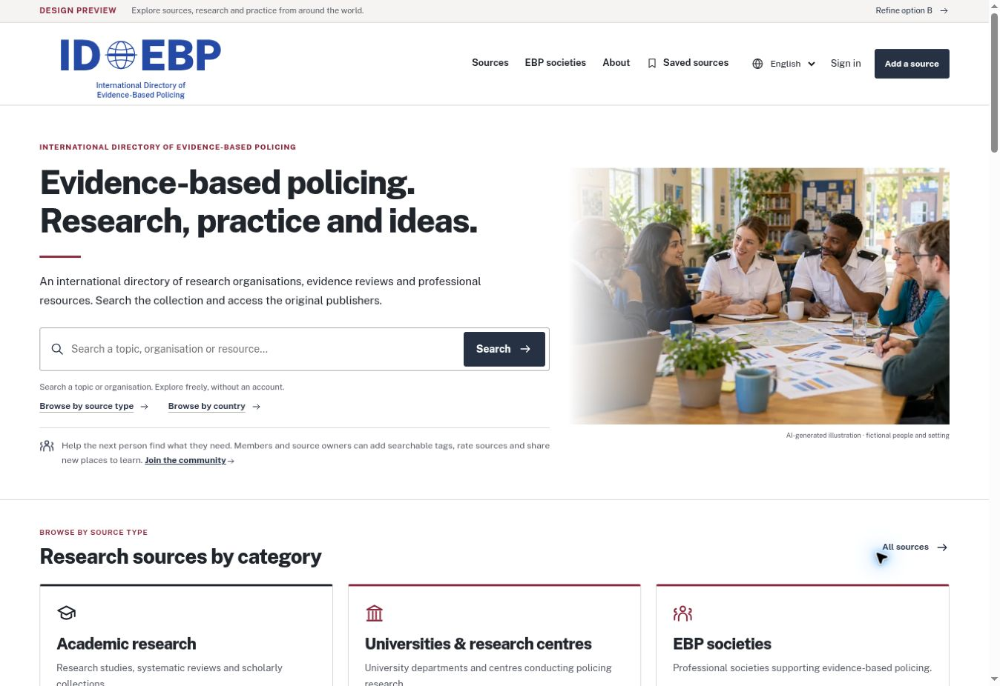

# Directory design review · 15 October 2026

This release applies Nathan’s revised Directory identity and design corrections. The B1 logo stays blue while headings and links use charcoal and dark ink. The hero fade and compact mobile image are restored; formal research headings replace conversational labels; societies appear before countries; the international research panel has a shaded background and a subtle collaboration image. The contribution heading is Add a source. Rating controls use stars, with numeric accessibility information hidden from the visual layout.

The source collection, source branding, original links, moderation and ranking logic are preserved. Existing account services remain inactive pending their separate setup.

## Verification

- All 64 existing automated tests passed, including source discovery, localisation, member ratings, moderation and database access policies.
- Production build contains 54 static assets. The deployed asset map was checked against the local build, and the backend code was verified unchanged before upload.
- Visually reviewed the live homepage at 1348px, 1024px, 390px and 320px widths. Checked category cards, source cards, society logos, section ordering, the shaded research panel and collaboration imagery.
- Corrected a menu wrap at 320px and reduced the collaboration-image caption to the intended unobtrusive size.
- Confirmed all homepage main headings render in charcoal, no horizontal overflow on the desktop view, no failed homepage images, and the totals settle at 115 sources and 35 countries.
- Visually checked the source profile: five star controls, no visible numeric rating scale. Numeric labels remain available to assistive technology.
- Searched the interface copy for the former identity and board/ambition wording; no matches remain. Original source organisation names are preserved.
- `git diff --check` passed.

## Publication

Published to the existing `idebp-preview` Worker serving https://id-ebp.org/ on 15 October 2026. Final deployment: `84196fd3028e459f8a3345785e60bb58`, recorded at 08:07:07 UTC. Existing bindings and runtime settings were preserved.

